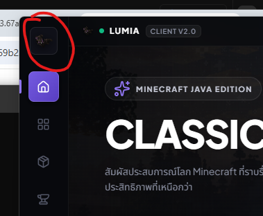

# Lumia Launcher 🦇

> Minecraft Java Edition Launcher สำหรับ Windows ดีไซน์ **Stealth Matte Dark UI** มินิมอล พร้อมระบบตรวจจับปัญหาอัจฉริยะ ล็อกอิน Microsoft ได้สะดวกรวดเร็ว

[](https://github.com/x2super/lumia-mc/releases/latest)
[](https://github.com/x2super/lumia-mc/releases/latest)
[](LICENSE)

---

## 📸 ภาพตัวอย่างโปรแกรม (Screenshot)

<p align="center">
  
</p>

---

## 📥 ดาวน์โหลดตัวติดตั้ง (Download Release)

ดาวน์โหลดเวอร์ชันล่าสุดสำหรับ Windows ได้ที่:

👉 **[ดาวน์โหลด Lumia.Launcher.Setup.1.1.0.exe](https://github.com/x2super/lumia-mc/releases/download/v1.1.0/Lumia.Launcher.Setup.1.1.0.exe)**  
หรือดูเวอร์ชันทั้งหมดที่หน้า **[GitHub Releases](https://github.com/x2super/lumia-mc/releases)**

---

## ✨ ฟีเจอร์หลัก (Key Features)

* 🎨 **Stealth Matte Dark UI**: ธีมดาร์กมินิมอลสบายตา พื้นหลังวิดีโออนิเมชันนุ่มนวล พร้อมการ์ดโปรไฟล์ที่เรียบหรู
* ⚡ **เล่นได้ทันที (Offline / Local Mode)**: ตั้งชื่อตัวละครเริ่มต้น `Lunia` แล้วกดเข้าเล่นได้เลย ไม่ต้องล็อกอินให้ยุ่งยาก
* 🔑 **Microsoft Account Integration**: รองรับการเข้าสู่ระบบด้วยบัญชี Microsoft อย่างปลอดภัย เล่นเซิร์ฟเวอร์ออนไลน์แท้ได้ทันที และเมื่อกดออกจากระบบชื่อจะกลับมาเป็นค่าเริ่มต้นอัตโนมัติ
* 📜 **Full Minecraft Version Support**: จัดหมวดหมู่เวอร์ชันเกมเรียงลำดับให้อย่างแม่นยำ (Official Releases & Snapshots) ครอบคลุมตั้งแต่ 1.0 ถึง 1.21+
* 🚀 **Smart Process Handling**: ย่อ/ซ่อนหน้าต่างตัวรันเกมอัตโนมัติขณะเปิดเกมเพื่อประหยัดทรัพยากร และดึงหน้าต่างกลับมาอัตโนมัติเมื่อปิดเกม
* 📊 **Realtime Telemetry**: มอนิเตอร์ Ping เครือข่าย, ปริมาณการใช้งาน RAM และสถานะระบบแบบ Realtime
* 🛡️ **Smart Diagnostics & Notification**: ระบบแจ้งเตือน Toast แบบดาร์กแมตต์ พร้อมระบบดักจับ Error และแนะนำวิธีแก้ไข Java/Driver อัจฉริยะ

---

## 🛠️ การพัฒนาและการบิลด์ (Development & Build)

### ข้อกำหนดเบื้องต้น
* **Node.js** v20 ขึ้นไป หรือ **Bun**
* **Java Runtime**: Java 21 (สำหรับ Minecraft 1.20.5+) หรือ Java 17 / 8 ตามเวอร์ชันเกมที่ต้องการ
* **ระบบปฏิบัติการ**: Windows 10 / 11 (64-bit)

### ขั้นตอนการรัน

```powershell
# ติดตั้ง dependencies
npm install

# ตรวจสอบโค้ด
npm run check

# รันโหมดทดสอบ
npm start

# บิลด์เป็นตัวติดตั้ง Windows Installer (.exe)
npm run dist
```

---

## 📄 ลิขสิทธิ์ (License)

โปรเจกต์นี้พัฒนาขึ้นภายใต้ลิขสิทธิ์ [MIT License](LICENSE)
